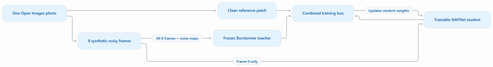

## Work Flow
- Build Dataset -> Using BNP method for building the burst and adding noise -> training the NAFNet
1. download_sample.py
2. train.py

## Dataset
- 20 000 distinct photos for training
- Seed = 4008
- Size condidtion: H or W must >= 640 pixels
- Perform the test like Burstormer

## Noise Setting
-`BNP` [Setting Reference](https://github.com/likesum/bpn/blob/main/utils/tf_utils.py)
- log₁₀(σread) uniformly from −3 to −1.5 -> This noise is independent of pixel brightness
- log₁₀(σshot) uniformly from −2 to −1 -> This noise gets stronger as the clean pixel gets brighter
- Creates eight noisy 128 × 128 RGB frames
- 

## Data Preprorocessing
1. Sourse images from `Open Image V6`
2. Burst geometry with using a Poisson-based probability
3. Exposure and noise with a log-uniform white level and Gaussian read and signal-dependent shot noise
4. Training pair
NOTE: Burst geometry, exposure and noise is referencing `BNP` [Link](https://github.com/likesum/bpn/blob/main/utils/tf_utils.py)

## NAFNet Training
- Input: Noisy frame 0
- width-32
- 100 epochs
- Learning rate = 1e-4
- L1 and Adam

## Test

## KD NAFNet (Two-Stage Offline Distillation)
- Plain NAFNet learns from the clean target
- Distilled NAFNet learns from the same clean target + Burstormer’s prediction
- Burstormer sees all eight frames during distillation. Both NAFNets still use frame 0 only, including at test time

### What Student Learns
- The connection is in the training loss (knowledge distillation)
- The loss function: $$L_{\text{total}} = L_{\text{GT}} + \lambda_{\text{KD}} \cdot L_{\text{KD}}$$
- GT loss measures how far NAFNet’s prediction is from the clean target.
- KD loss measures how far NAFNet’s prediction is from Burstormer’s prediction.
- Burstormer’s prediction acts as a second target that guides the weight update.

| | Input | Output |
|---|---|---|
| **Teacher · pretrained Burstormer** | All eight noisy frames plus a noise estimate for each frame | One denoised image corresponding to frame 0 |
| **Student · NAFNet initialized from epoch 50** | Noisy frame 0 | One denoised image corresponding to frame 0 |